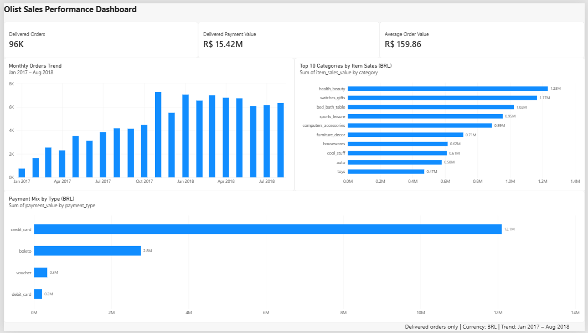

# Olist E-Commerce Sales Dashboard

An end-to-end e-commerce sales analysis project using **Python, SQL (SQLite), and Power BI**. The project analyzes order delivery, payment trends, product category sales, and customer reviews using the Brazilian E-Commerce Public Dataset by Olist.

## Dashboard Preview



## Business Questions

- How many orders were placed and delivered?
- What is the total payment value generated by delivered orders?
- How do monthly order volumes and payment values change over time?
- Which product categories generate the highest item sales?
- Which payment methods account for the largest share of payment value?
- What is the average customer review score?

## Dataset

Source: [Brazilian E-Commerce Public Dataset by Olist — Kaggle](https://www.kaggle.com/datasets/olistbr/brazilian-ecommerce)

The dataset contains approximately 100,000 orders from 2016–2018.

The original dataset, local SQLite database, and Power BI `.pbix` file are not included in this repository. Download the dataset from Kaggle and follow its license terms.

## Key Metrics

| Metric | Value |
|---|---:|
| Total orders (all statuses) | 99,441 |
| Delivered orders | 96,478 |
| Delivered rate | 97.02% |
| Delivered payment value | R$ 15,422,461.77 |
| Average order value (AOV) | R$ 159.86 |
| Delivered item sales value (excluding freight) | R$ 13,221,498.11 |
| Average review score | 4.09 / 5 |

## Key Findings

- **Order delivery:** 96,478 of 99,441 orders were delivered, representing a delivery rate of 97.02%.
- **Payment mix:** Credit cards contributed approximately 78.46% of delivered payment value, followed by boleto at 17.96%, vouchers at 2.22%, and debit cards at 1.35%.
- **Peak month:** November 2017 recorded the highest monthly delivered payment value, at approximately R$ 1.15 million.
- **Sales growth:** Monthly delivered payment value increased substantially during 2017 and remained above R$ 1 million in several months of 2018.
- **Product categories:** Health and beauty, watches and gifts, and bed, bath and table were among the leading categories by item sales value.

## Data Quality and Metric Definitions

**Documentation:**

- [Data Quality Checks](docs/data_quality_checks.md)
- [Metric Definitions](docs/metrics_definitions.md)
- [AI-Assisted Workflow](docs/ai_workflow.md)

**Key notes:**

- The database contains eight tables loaded from the supplied CSV files.
- One delivered order has no payment record. Therefore, AOV is calculated using 96,477 delivered orders with payment records.
- Orders may have multiple payment records, such as installments. Payment totals and order counts must therefore be interpreted according to the SQL query's aggregation method.
- Some months at the beginning and end of the dataset have very few orders.
- Monthly order exports include delivered orders only.
- Category sales exports include delivered-order items only.
- The average review score is calculated over all reviews and is not filtered by order status.
- Item sales value is calculated using item prices and excludes freight. Payment value is calculated from payment records, so the two totals are not expected to match.
- The monthly order export totals 96,478 delivered orders, and category item sales total R$ 13,221,498.11.

## Tools and Technologies

- **Python:** pandas, sqlite3, pathlib
- **SQL:** SQLite, aggregation, joins, filtering, and date-based grouping
- **Power BI:** Dashboard development and visualization
- **Git and GitHub:** Version control and project documentation

## Methodology

1. Profile the raw CSV datasets using Python.
2. Load the datasets into a local SQLite database.
3. Run SQL queries for order status, payment value, monthly trends, category sales, AOV, and review scores.
4. Export aggregated dashboard datasets as CSV files.
5. Build the Power BI dashboard using the processed datasets.
6. Validate key metrics against the SQL results.

## Project Structure

```text
sales-dashboard-olist/
├── data/
│   ├── raw/                       # Original CSV datasets (not tracked)
│   └── processed/                 # Dashboard summary CSVs
├── docs/
│   ├── ai_workflow.md
│   ├── data_quality_checks.md
│   └── metrics_definitions.md
├── screenshots/
│   ├── README.md
│   └── dashboard_v1.png
├── scripts/
│   ├── load_data.py
│   ├── load_to_sqlite.py
│   ├── run_sql.py
│   ├── export_dashboard_data.py
│   ├── export_payment_mix.py
│   └── check_aov.py
├── sql/
│   ├── sales_analysis.sql
│   └── 05_payment_mix.sql
├── README.md
├── requirements.txt
└── .gitignore
```

The SQLite database and Power BI project file are maintained locally and are not included in the repository.

## How to Run

Run the commands from the project root.

### 1. Install dependencies

```bash
python -m pip install -r requirements.txt
```

### 2. Add the raw datasets

Download the Kaggle dataset and place these eight CSV files in `data/raw/`: customers, orders, order_items, order_payments, order_reviews, products, sellers and product_category_name_translation. Leave out `olist_geolocation_dataset.csv`, because the scripts load every CSV found in that folder.

### 3. Run the analysis scripts

```bash
python scripts/load_data.py
python scripts/load_to_sqlite.py
python scripts/run_sql.py
python scripts/export_dashboard_data.py
python scripts/export_payment_mix.py
python scripts/check_aov.py
```

### 4. Open the dashboard

Open the processed CSV files from `data/processed/` in Power BI Desktop and recreate the dashboard visuals.

## Limitations and Future Improvements

- The dashboard currently uses pre-aggregated CSV files, which limits cross-filtering between visuals.
- A future version could use a relational data model and DAX measures for interactive analysis.
- The dataset covers 2016–2018 and does not represent current e-commerce activity.
- Payment value and item sales value are different metrics and should not be compared as equivalent revenue measures.

## AI-Assisted Workflow

AI tools supported parts of the SQL, Power BI metric-definition, and documentation workflow. Suggestions were reviewed against query outputs and independent calculations. Workflow notes are available in [`docs/ai_workflow.md`](docs/ai_workflow.md).

## Author

**Priya Mali**  
M.Sc. Computer Science (Big Data Analytics)


